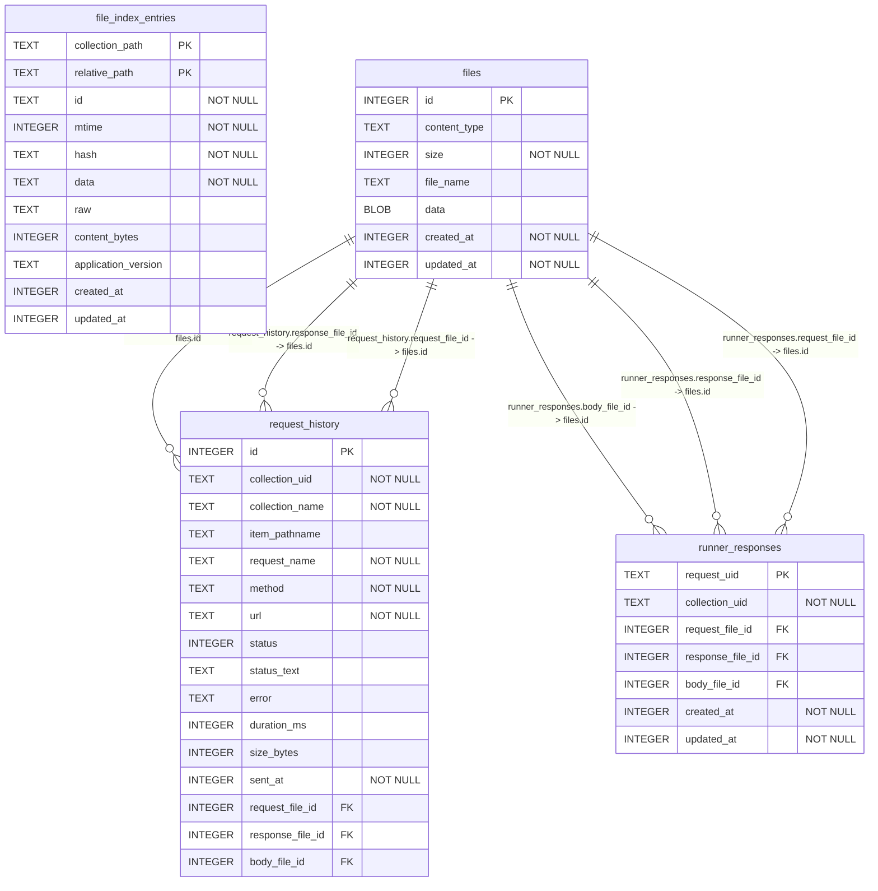

# @ferretclient/sqlite schema

> Generated by `npm run schema` from `migrations/` — do not edit by hand.

Migrations applied: `0000001_runner_responses`, `0000002_file_index_entries`, `0000003_files`, `0000004_runner_response_files`, `0000005_request_history`

## `file_index_entries`

`WITHOUT ROWID`

| Column | Type | Not null | Default | Key |
|---|---|---|---|---|
| `collection_path` | TEXT | yes |  | PK (1) |
| `relative_path` | TEXT | yes |  | PK (2) |
| `id` | TEXT | yes |  |  |
| `mtime` | INTEGER | yes |  |  |
| `hash` | TEXT | yes |  |  |
| `data` | TEXT | yes |  |  |
| `raw` | TEXT |  |  |  |
| `content_bytes` | INTEGER |  |  |  |
| `application_version` | TEXT |  |  |  |
| `created_at` | INTEGER |  |  |  |
| `updated_at` | INTEGER |  |  |  |

**Indexes**

- `idx_file_index_lookup` on (`collection_path`, `relative_path`)

## `files`

| Column | Type | Not null | Default | Key |
|---|---|---|---|---|
| `id` | INTEGER |  |  | PK |
| `content_type` | TEXT |  |  |  |
| `size` | INTEGER | yes | `0` |  |
| `file_name` | TEXT |  |  |  |
| `data` | BLOB |  |  |  |
| `created_at` | INTEGER | yes | `unixepoch()` |  |
| `updated_at` | INTEGER | yes | `unixepoch()` |  |

## `request_history`

| Column | Type | Not null | Default | Key |
|---|---|---|---|---|
| `id` | INTEGER |  |  | PK |
| `collection_uid` | TEXT | yes |  |  |
| `collection_name` | TEXT | yes | `''` |  |
| `item_pathname` | TEXT |  |  |  |
| `request_name` | TEXT | yes | `''` |  |
| `method` | TEXT | yes | `''` |  |
| `url` | TEXT | yes | `''` |  |
| `status` | INTEGER |  |  |  |
| `status_text` | TEXT |  |  |  |
| `error` | TEXT |  |  |  |
| `duration_ms` | INTEGER |  |  |  |
| `size_bytes` | INTEGER |  |  |  |
| `sent_at` | INTEGER | yes |  |  |
| `request_file_id` | INTEGER |  |  |  |
| `response_file_id` | INTEGER |  |  |  |
| `body_file_id` | INTEGER |  |  |  |

**Foreign keys**

- `body_file_id` → `files.id`
- `response_file_id` → `files.id`
- `request_file_id` → `files.id`

**Indexes**

- `idx_request_history_sent_at` on (`sent_at`, `id`)

## `runner_responses`

| Column | Type | Not null | Default | Key |
|---|---|---|---|---|
| `request_uid` | TEXT |  |  | PK |
| `collection_uid` | TEXT | yes |  |  |
| `request_file_id` | INTEGER |  |  |  |
| `response_file_id` | INTEGER |  |  |  |
| `body_file_id` | INTEGER |  |  |  |
| `created_at` | INTEGER | yes | `unixepoch()` |  |
| `updated_at` | INTEGER | yes | `unixepoch()` |  |

**Foreign keys**

- `body_file_id` → `files.id`
- `response_file_id` → `files.id`
- `request_file_id` → `files.id`
